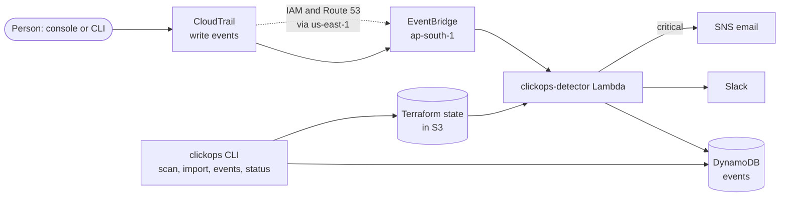

# clickops

Alerts on Slack when someone changes Terraform-managed AWS infrastructure outside Terraform.

## The problem

Someone fixes an incident in the AWS console and Terraform no longer describes what is running. Nobody
notices until the next `terraform apply` quietly reverts the fix, or until an audit finds a security
group open to the world. clickops watches CloudTrail, tells you on Slack within a few minutes who
changed what and how it differs from Terraform state, and can turn console-made resources into Terraform code.

## Demo


The GIF is recorded from [`demo/demo.tape`](demo/demo.tape) with VHS and is added by the owner after
the first live run (see [`demo/README.md`](demo/README.md)). Example alert messages are in
[`docs/alert-examples.md`](docs/alert-examples.md).

## What it detects

Exactly six resource types in one account: each has a resolver (event to resource) and a comparator
(live configuration against Terraform state).

| Resource | Watched changes | Compared with state |
| --- | --- | --- |
| Security group | rules authorised or revoked, group created or deleted | ingress and egress rules |
| IAM role and policy | role created or deleted, trust policy updated, inline policies put or deleted, managed policies attached or detached | trust policy, inline policies, attached policy ARNs; for a managed policy, its document |
| S3 bucket | bucket created or deleted, policy, public access block, versioning, encryption | only the settings that have a Terraform resource: policy, public access block flags, versioning, encryption algorithm |
| EC2 instance | launched, started, stopped, terminated, attribute modified | instance type, security groups, instance profile, running or stopped |
| Lambda function | created, deleted, configuration or code updated, permission added | runtime, handler, memory, timeout, role, code hash, environment variable names |
| Route 53 record | record sets changed | name, type, TTL, values |

Resources found in no state are reported as `shadow-create`. The outcome and severity table is under
[Outcomes and severity](#outcomes-and-severity) below, and the actor classes (console person, CLI person, CI,
AWS service, clickops itself) are in [`docs/architecture.md`](docs/architecture.md).

### Outcomes and severity

Every watched change is stored with one of these outcomes and a severity. Only the rows with a
severity above "none" are alerted.

| Outcome | Meaning | Default severity |
| --- | --- | --- |
| `managed-drift` | a person changed a resource that is in Terraform state | warning |
| `managed-delete` | a person deleted a resource that is in Terraform state | critical |
| `shadow-create` | a person created a resource that no state knows about | info |
| `tamper` | anyone other than `clickops-ci` stopped or changed clickops' own trail, event rules or detector function (`StopLogging`, `DeleteTrail`, `UpdateTrail`, `PutEventSelectors`, `DisableRule`, `DeleteRule`, `RemoveTargets`, `DeleteFunction`, `UpdateFunctionCode`) | critical |
| `ignored` | the actor is CI, clickops itself or an AWS service; the resource is opted out (`clickops:ignore=true` or an ignore rule); it is not managed by Terraform; or the live configuration matches state | none |

Any outcome except `ignored` becomes **critical** when the change allows ingress from `0.0.0.0/0`
or `::/0` on a port other than 80 or 443, grants an IAM policy with `*` as the action or resource
together with a write action, or disables S3 Block Public Access. A `tamper` outcome cannot be
silenced by tags, ignore rules or severity overrides.

## Architecture



The Lambda is the only moving part. The full event path, the three Terraform roots and the data model
are in [`docs/architecture.md`](docs/architecture.md).

## Quickstart

You need an AWS account you can experiment in, the AWS CLI with a profile named `clickops-admin`,
Terraform 1.10 or newer, Python 3.12 with [uv](https://docs.astral.sh/uv/), and a Slack incoming webhook.
Every `terraform apply` creates real resources, so read each plan first.

1. **Clone and install.**

   ```
   git clone https://github.com/<owner>/clickops && cd clickops
   uv sync
   uv run clickops --version
   ```

2. **Bootstrap** the state bucket and the CI role (local state, applied once). Details in
   [`infra/bootstrap/README.md`](infra/bootstrap/README.md).

   ```
   cd infra/bootstrap
   cp bootstrap.auto.tfvars.example bootstrap.auto.tfvars   # set account_id and github_owner
   AWS_PROFILE=clickops-admin terraform init && AWS_PROFILE=clickops-admin terraform apply
   cd ../..
   ```

3. **Apply the sandbox**, the small stack that gets drifted on purpose. Details in
   [`infra/sandbox/README.md`](infra/sandbox/README.md).

   ```
   cd infra/sandbox
   cp backend.hcl.example backend.hcl                       # set the state bucket name
   echo 'admin_cidr = "<your-ip>/32"' > sandbox.auto.tfvars
   AWS_PROFILE=clickops-admin terraform init -backend-config=backend.hcl
   AWS_PROFILE=clickops-admin terraform apply
   cd ../..
   ```

4. **Configure.** The detector zip includes `clickops.yaml` (ignore rules and severity overrides), so create it
   before building. Replace every `<...>` placeholder: the bucket is the `state_bucket` output of the bootstrap
   root (`clickops-tfstate-<account-id>`), and `clickops` refuses a file that still has placeholders. Delete the
   example `trusted_roles` and `ignore` entries if you have none.

   ```
   cp clickops.example.yaml clickops.yaml
   $EDITOR clickops.yaml
   ```

5. **Build and apply the detector**, store the Slack webhook (the script prompts for it without echoing, so it
   never enters your shell history), confirm the SNS email, and check. Role ARNs that should count as CI
   also go in `trusted_role_arns` in `detector.auto.tfvars`. After you change `clickops.yaml` later, run the
   build and the apply again. Details in [`infra/detector/README.md`](infra/detector/README.md).

   ```
   scripts/build_lambda.sh
   cd infra/detector
   cp backend.hcl.example backend.hcl                       # set the state bucket name
   cp detector.auto.tfvars.example detector.auto.tfvars     # set alert_email
   AWS_PROFILE=clickops-admin terraform init -backend-config=backend.hcl
   AWS_PROFILE=clickops-admin terraform apply
   cd ../..
   AWS_PROFILE=clickops-admin scripts/store_slack_webhook.sh
   AWS_PROFILE=clickops-admin uv run clickops doctor
   AWS_PROFILE=clickops-admin uv run clickops status
   ```

Make a harmless change in the console (change the sandbox Lambda's timeout, for example) and an
alert arrives within a few minutes. `scripts/e2e_alerts.sh` does this from the command line.

Afterwards, `clickops scan` lists shadow resources, `clickops import` drafts Terraform for them and
`clickops events --since 1h` shows what was detected. All commands are listed under [Commands](#commands).

### Commands

| Command | What it does |
| --- | --- |
| `clickops doctor` | checks credentials, Terraform, the config and read access to the state files |
| `clickops events --since 1h` | shows stored events, oldest first |
| `clickops scan` | lists live resources of the six types that are in no Terraform state |
| `clickops import` | writes Terraform `import` blocks for shadow resources and drafts their config |
| `clickops status` | checks that the trail is logging, the rules are enabled, the dead-letter queue is empty and no alarm is open |

## Cost

About USD 1.25 per month for the sandbox (a private hosted zone and an 8 GB volume under a stopped
instance). The detector's trail copy of management events is free, and DynamoDB on-demand, Lambda, SNS
and EventBridge stay inside the free tier or cost cents at this volume. A USD 5 monthly AWS Budget is
recommended as a guardrail. Itemised in [`docs/cost.md`](docs/cost.md). There is no NAT gateway, load balancer or RDS.

## Security model

clickops only reads: its Lambda can read the Terraform state, describe the six resource types and write
its own table, and it has no permission to change what it watches. GitHub Actions reaches AWS through
OIDC with a role scoped to this repository's `main` branch and to named clickops resources, and there
are no long-lived access keys. The Slack webhook lives in SSM Parameter Store as a SecureString. Anything
that stops the trail, disables a rule or replaces the function raises a critical `tamper` alert that tags
and ignore rules cannot silence. What an attacker holding each identity can do, and what clickops does not
protect against, is in [`docs/threat-model.md`](docs/threat-model.md).

## Limitations

- Six resource types only: security group, IAM role and policy, S3 bucket, EC2 instance, Lambda function
  and Route 53 record.
- One AWS account.
- One region (`ap-south-1`), plus global IAM and Route 53 events that arrive in `us-east-1`.
- Alerts arrive a few minutes after the change, because CloudTrail delivers events to EventBridge with a delay.
- It reports and never reverts: undoing a change is up to you.
- It reads Terraform state from S3 only, and the state must be readable by the detector.
- The first alerts of a new setup have not been checked against real recorded events: the fixtures are
  synthetic until someone runs `scripts/fetch_fixtures.py` against a live account.

## How it differs from a scheduled `terraform plan`

A scheduled plan tells you that something differs, some hours later, with no idea who did it. clickops reacts
to the API call itself, so the alert names the person, whether they used the console or the CLI, and which
attribute changed. A plan sees only resources Terraform already manages, while clickops also reports
resources created in the console that no state knows about and offers to import them. A plan needs
credentials able to refresh every resource in every state, where clickops reads state and describes only the resource that changed. A scheduled plan is still the right check for drift that happens without an API call,
such as a provider upgrade, so the two complement each other.
