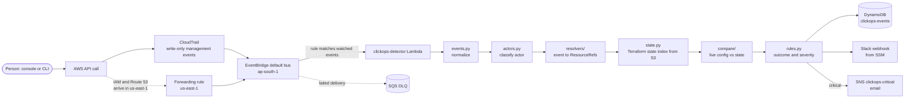
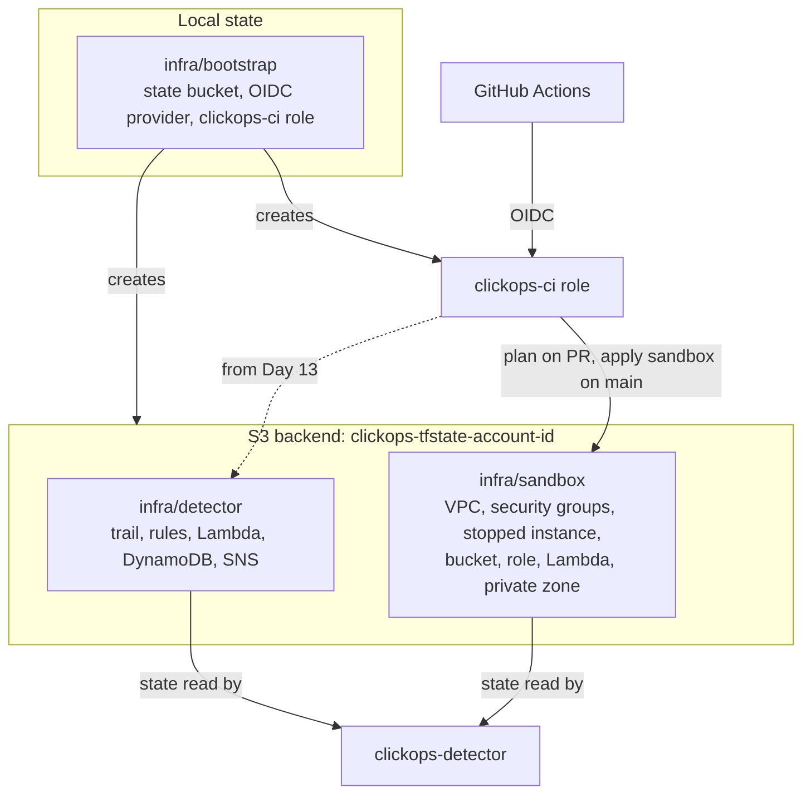

# Architecture

clickops watches one AWS account in `ap-south-1`. A write call recorded by CloudTrail travels through
EventBridge to one Lambda, which decides whether the change was made outside Terraform and, if so,
stores it and alerts Slack.

## Event flow

Everything left of the Lambda is AWS doing its normal job; everything right of it is output.

## Outcomes

| Outcome | Meaning | Default severity |
| --- | --- | --- |
| `managed-drift` | a person changed a resource that is in Terraform state | warning |
| `managed-delete` | a person deleted a resource that is in Terraform state | critical |
| `shadow-create` | a person created a resource that no state knows about | info |
| `ignored` | actor is CI, clickops itself or an AWS service, or the resource is opted out | none |

## Terraform roots

- `bootstrap` is applied once by hand with the `clickops-admin` profile; its local state stays on that machine.
- `sandbox` is the infrastructure that gets drifted on purpose, so clickops has something to watch.
- `detector` is clickops itself. The detector Lambda reads the sandbox and detector state files with `s3:GetObject` on those two keys only.

## Actor classes

Checked in this order: `clickops-self`, `ci`, `aws-service`, `console-human`, `cli-human`.

## Package layout

One Python package, `clickops`, serves the CLI (`typer`, `rich`) and the Lambda (`handler.py`). Models and
config use pydantic v2. Tests use moto and the CloudTrail fixtures in `tests/fixtures/cloudtrail/`.
